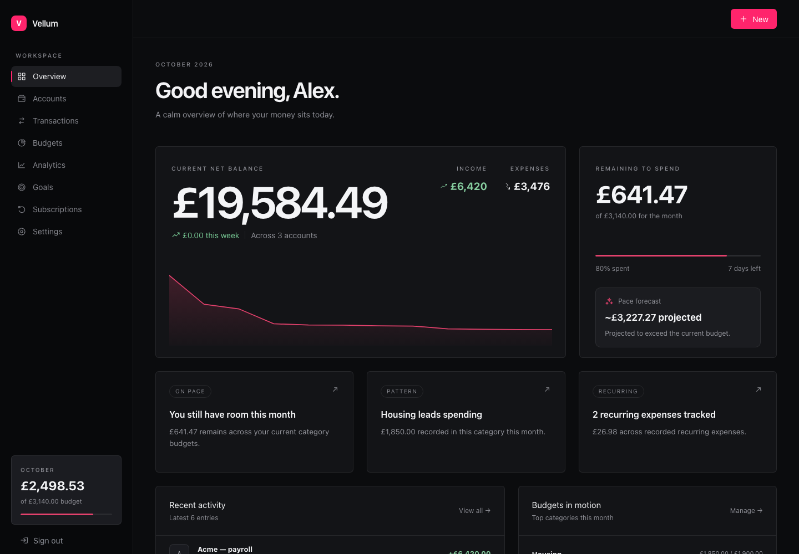
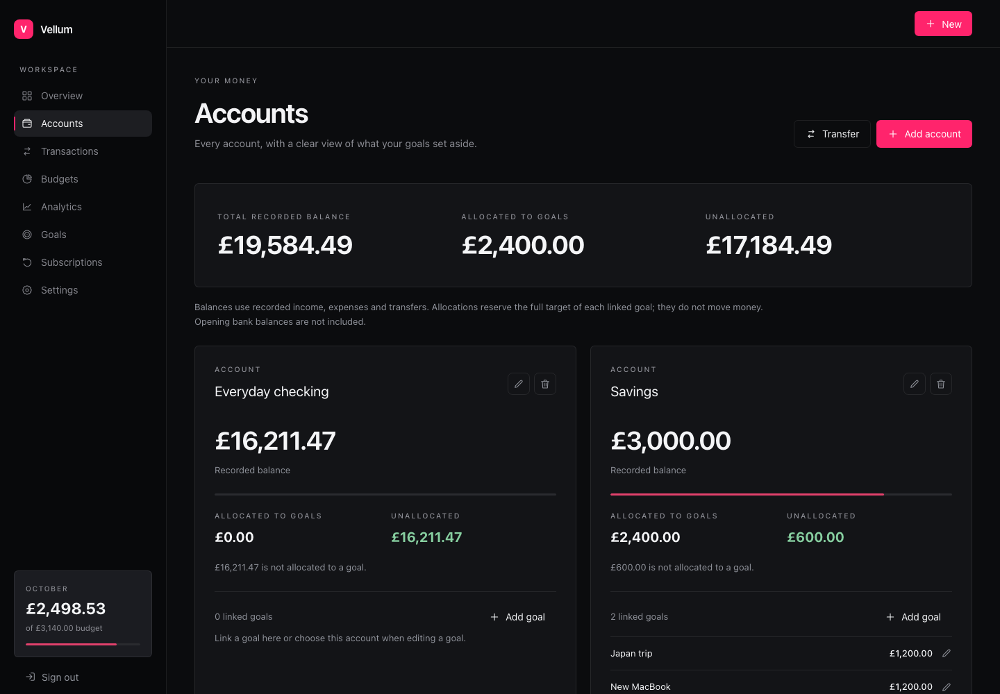
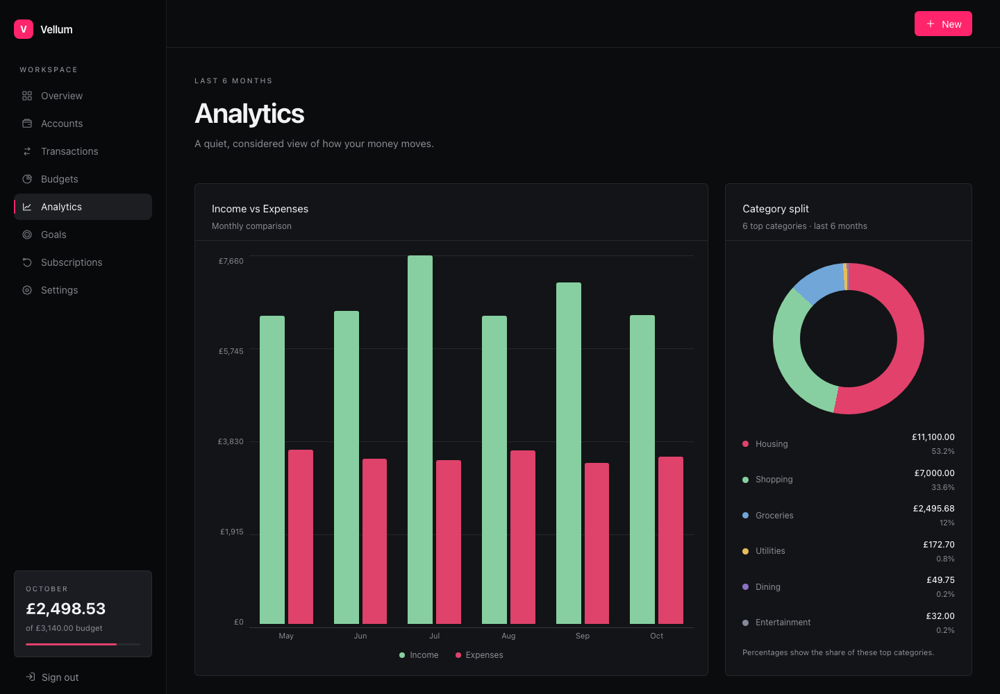
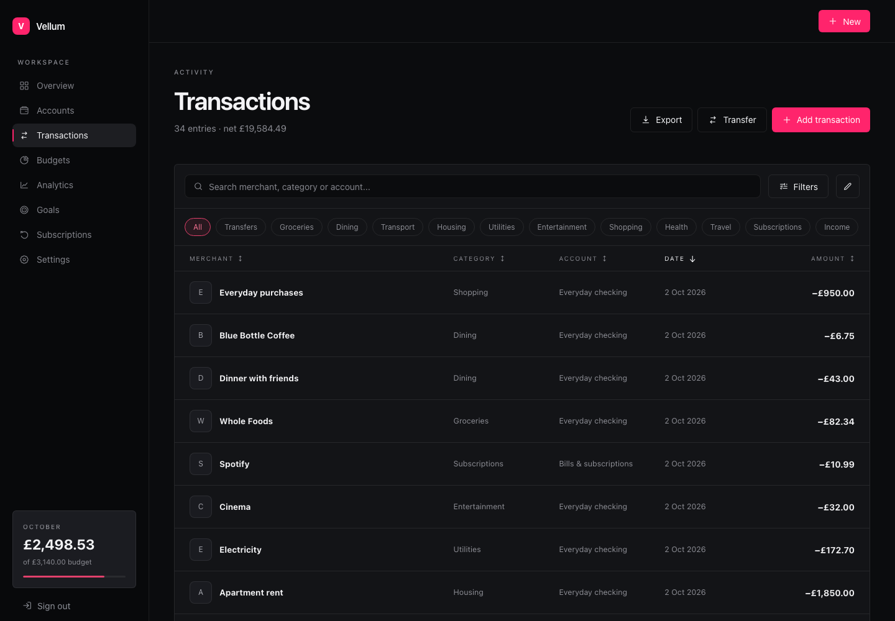
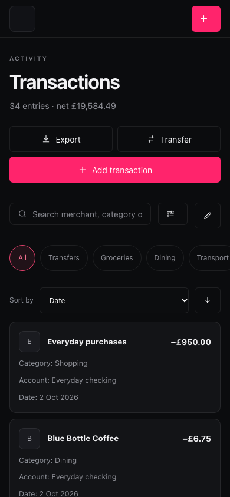
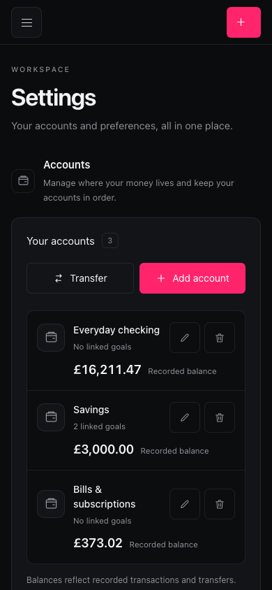

# Vellum

A personal-finance application for understanding your money across accounts,
category budgets, and savings goals. Built with **React, TypeScript, Tailwind CSS,
Go, and PostgreSQL**.



## What you can do

- Record income and expenses, search/filter/sort activity, edit records, and export
  the visible transactions as CSV.
- Move money between accounts without inflating income or spending. Transfers
  support the same frequency choices as other entries.
- Set category budgets and compare them with the current month's spending.
- Link goals to an account and see how much remains unallocated—or the shortfall
  if goal targets exceed the recorded balance.
- Review six-month income/expense charts and a labeled category breakdown.
- Manage accounts and display preferences across desktop, tablet, and mobile.

Vellum uses persisted API data. It is a manual tracker: bank synchronization,
opening balances, currency conversion, and automatically generated recurring
occurrences are not implemented. A frequency marks a recorded entry as recurring;
it does not schedule a payment or create future ledger entries.

## Screenshots

All screenshots use synthetic records generated through the real API in a
throwaway database. No personal financial information is included.

| Account balances and goal reservations     | Income, expenses, and categories             |
| ------------------------------------------ | -------------------------------------------- |
|  |  |

<details>
<summary>Transactions and mobile views</summary>






</details>

## Engineering decisions

**Transfers preserve financial totals.** One transfer row represents both account
movements. Updating or deleting it changes both effects together, and transfers
remain excluded from income, expense, and budget totals.

**Account availability is calculated on the server.** Owner-scoped SQL aggregates
combine recorded transactions, transfers, and linked goal targets without
multiplying totals through multi-way joins. Two goals of 1,200 against a 3,000
recorded balance leave 600 unallocated. Allocation reserves the full target,
independently of saved progress, and does not move money.

**Authentication handles failure and concurrency.** Passwords are hashed with
bcrypt; refresh tokens are random, stored hashed, rotated transactionally, and
revoked on logout. Registration commits its user, default settings, and initial
refresh token together. The client coordinates simultaneous expired requests
through one refresh promise. Browser tokens currently use localStorage.

**Integrity is enforced beyond the UI.** Services check ownership and related
accounts; repository mutations include the user ID; PostgreSQL enforces transfer
constraints and one budget per user/category. Existing duplicate budgets stop
migration with an actionable error instead of being silently removed.

## Architecture and stack

```text
React feature modules → typed Axios APIs → Gin routes / JWT middleware
                                              ↓
                                    handlers → services
                                              ↓
                                    repository interfaces
                                              ↓
                                      GORM → PostgreSQL
```

| Layer          | Implementation                                                                                        |
| -------------- | ----------------------------------------------------------------------------------------------------- |
| Frontend       | React 19, TypeScript 6, Vite 8, TanStack Router, Tailwind CSS 4                                       |
| State and HTTP | React Context, component state, Axios with refresh/retry handling                                     |
| Backend        | Go 1.26.4, Gin, GORM, explicit dependency construction                                                |
| Database       | PostgreSQL 17, UUID models, startup AutoMigrate and idempotent category seeding                       |
| Verification   | Go tests/PostgreSQL integration, Node finance/architecture tests, Playwright desktop/mobile workflows |
| Development    | pnpm 10.17.0, Docker Compose, Air                                                                     |

The frontend keeps each feature's pages, forms, utilities, tests, and styles
close together. Shared UI, layout, API contracts, and finance state remain
separate. Automated import-graph checks protect feature boundaries.

## Run locally

### Docker Compose

Requirements: Docker and Docker Compose v2.

```sh
cp backend/.env.example backend/.env
```

Set `JWT_SECRET` in that local file to a long random value, then start:

```sh
docker compose up --build
```

| Service      | Address                    |
| ------------ | -------------------------- |
| Web client   | http://localhost:5173      |
| REST API     | http://localhost:8080      |
| Health check | http://localhost:8080/ping |
| PostgreSQL   | localhost:5432             |

Compose injects backend configuration at runtime. Context-specific Docker ignore
rules keep environment files and credentials out of image builds. The example
contains local development defaults only. Register a new user in the browser;
canonical categories are created automatically when the API starts.

`docker compose down` stops the stack and retains data. Adding `-v` deletes its
local database volume.

### Run from source

Use Go 1.26.4, Node 25.2.1, pnpm 10.17.0, and a reachable PostgreSQL instance.
Create the same local environment file and use `DB_HOST=localhost` when Go runs
on the host. Start the API and client in separate terminals:

```sh
cd backend
go run ./cmd/server
```

```sh
cd frontend
pnpm install --frozen-lockfile
pnpm dev
```

`VITE_API_BASE_URL` configures the browser API URL. The API accepts
`CORS_ALLOWED_ORIGINS` as a comma-separated list, defaulting to
`http://localhost:5173`.

## Try a complete workflow

1. Register and add two accounts: Salary and Bills.
2. Record 3,000 income in Salary, transfer 600 to Bills, then record a 100 expense
   in Bills. Account balances become 2,400 and 500; the total is 2,900.
3. Add a category budget and inspect its current-month spending.
4. Create a goal linked to an account and inspect its remaining availability.
5. Filter/sort activity, enter edit mode, export CSV, and review Analytics.

## Tests and CI

[The CI workflow](.github/workflows/ci.yml) runs on pushes and pull requests with
separate frontend, PostgreSQL/backend, Docker-context, and browser jobs. A green hosted run must be checked on GitHub rather than inferred from local
results.

Frontend checks:

```sh
cd frontend
pnpm test
pnpm test:e2e:check
pnpm build
pnpm lint
pnpm format:check
```

Backend checks:

```sh
cd backend
go build ./...
go vet ./...
go test ./...
```

Without `TEST_DATABASE_DSN`, PostgreSQL tests skip. For the complete backend suite,
point that variable at a **disposable test database**, then run
`go test -count=1 -p 1 ./...`. Tests create schemas and run migrations; never use
a personal/deployed database. CI supplies its own PostgreSQL service and rejects
unexpected skipped tests.

### Browser workflows

Requirements: Docker, Go, frontend dependencies, and Chromium:

```sh
cd frontend
pnpm exec playwright install chromium
pnpm test:e2e
```

The runner creates a disposable PostgreSQL container and temporary Go binary,
starts dedicated API/frontend servers on ports **18080/15173**, and removes them
afterward. It refuses occupied ports and never reuses the regular application
servers. Test users and records are synthetic. PostgreSQL uses localhost-only
trust authentication inside this throwaway environment; that is not deployment
configuration.

The suite covers registration/login/logout, protected routes, transfer balances,
goal allocation/unlinking, duplicate budgets, activity edit/sort/filter/export,
settings persistence, refresh success/failure, and mobile navigation. Failure
traces/screenshots/video are retained in ignored report directories and uploaded
by CI when a browser job fails.

Regenerate the README images with `pnpm screenshots`. This uses the same isolated
stack and a separate opt-in screenshot fixture.

## Current limits and release work

This repository provides a working local application and automated verification,
not a verified public production deployment. The Dockerfiles remain development
images running Air and Vite. Remaining release work includes production serving,
HTTPS, authentication throttling/request limits, backup/restore procedures,
controlled schema migrations, and a reviewed browser session/CSP policy.

Goal progress and contribution estimates are entered manually. Budgets represent
current category limits rather than historical budget periods. Week-start is a
stored preference with a preview; there is no weekly calendar consuming it yet.
Password recovery/email verification and bank/provider integrations are outside
the implemented scope.

## More detail

- [Frontend structure and authentication](frontend/README.md)
- [Backend contracts, environment, and testing](backend/README.md)
- [Architecture specification](docs/architecture-specification.md)

Staging CI/CD deployment verification.
Verify the updated deployment controller.
