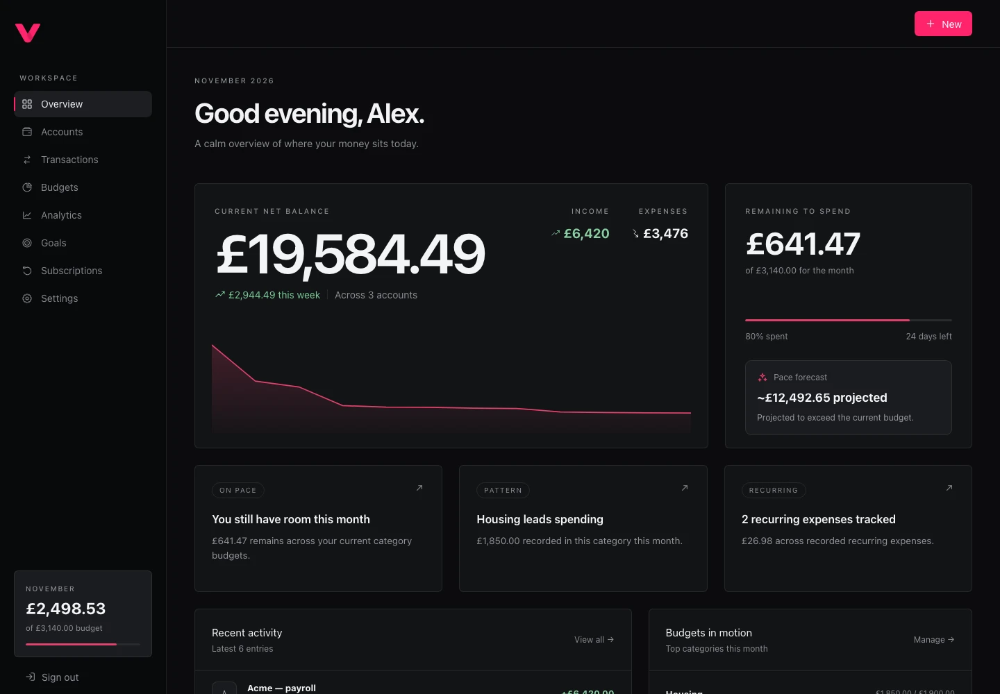
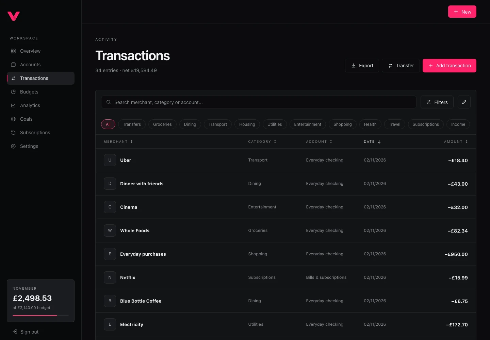
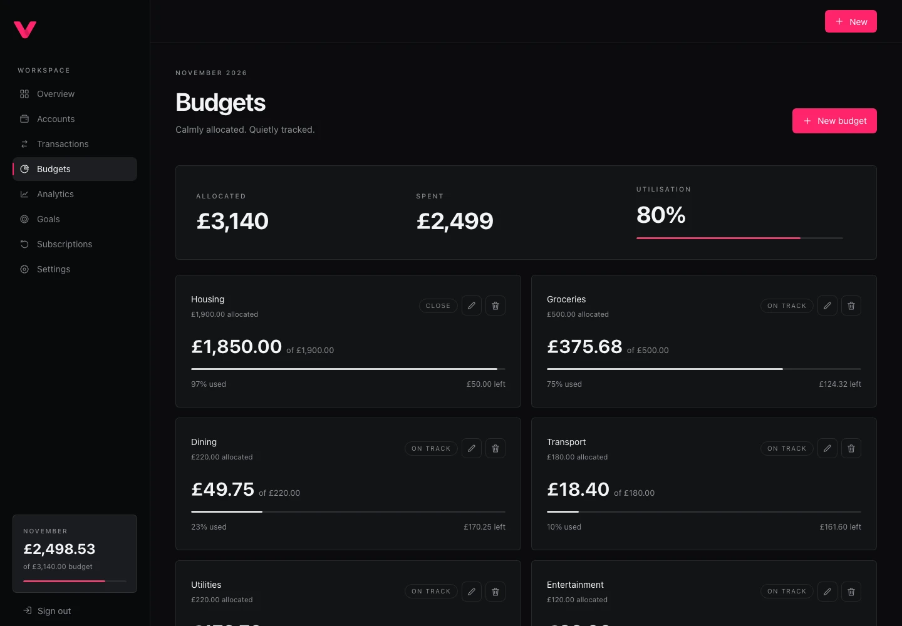
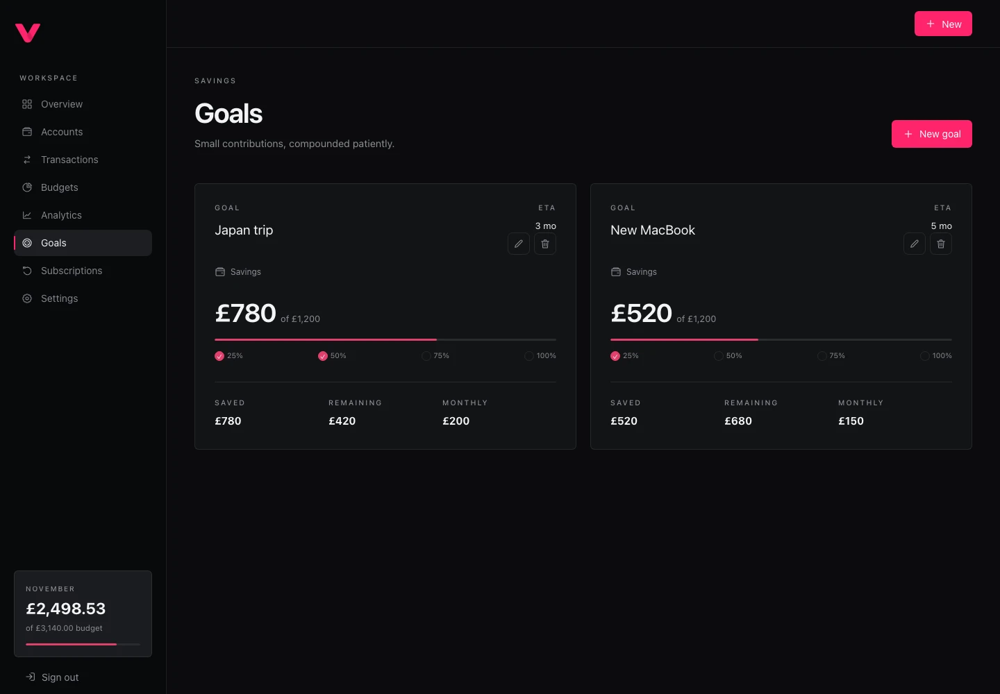
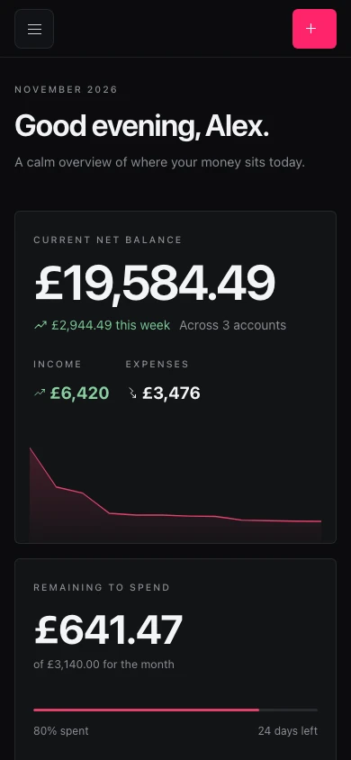

# Vellum

Vellum is a manual personal finance tracker. Record income, expenses and
transfers across your accounts, then see how much you have available, where
you are spending and what you have set aside for savings goals.

[Open Vellum](https://vellum.kacpergajdarski.com/) · [Run it locally](#run-locally) · [Technical architecture](TECHNICAL.md)



Sign in or create an account to open the workspace. Vellum asks you to add at
least one tracking account on first use. It uses a label you choose and requires
no bank credentials.

## What you can do

- **Track accounts and activity.** Record income and expenses, search and filter
  activity, and export the visible rows as CSV. Transfers change both account
  balances without counting as income or spending.
- **Budget and save.** Compare current-month category spending with budget
  limits. Track savings progress manually, and optionally allocate a goal's
  target against the balance of a linked account.
- **See the bigger picture.** Review recorded balances, recent activity,
  six-month income and spending trends, and expense categories. The
  Subscriptions page groups entries you have marked as recurring.
- **Manage access and preferences.** Register, sign in and sign out across
  browser tabs, and save currency display and formatting preferences. Email
  password recovery is available where sending is configured.

## Screenshots

These captures use synthetic records entered through the local API.

| Transactions                                                                                     | Budgets                                                                                                    | Goals                                                                                                  |
| ------------------------------------------------------------------------------------------------ | ---------------------------------------------------------------------------------------------------------- | ------------------------------------------------------------------------------------------------------ |
|  |  |  |

<details>
<summary>Mobile overview</summary>



</details>

## Technology and architecture

| Area                 | Stack                                                                                                   |
| -------------------- | ------------------------------------------------------------------------------------------------------- |
| Frontend             | React, TypeScript, Vite, TanStack Router, Tailwind CSS, Axios                                           |
| Backend              | Go, Gin, GORM                                                                                           |
| Data                 | PostgreSQL 17, with money represented in integer minor units                                            |
| Hosting and delivery | Docker Compose, Caddy, Nginx, AWS EC2 and Systems Manager, GitHub Actions and GitHub Container Registry |
| Verification         | Go unit, integration and race tests, Node's test runner, Playwright, ESLint and Prettier                |

In the deployed design, Caddy terminates HTTPS and routes browser pages and
assets to Nginx. API and authentication requests go to the Go service, which
uses PostgreSQL for application and session data. Staging and production use
separate databases and Compose projects on the same host. See the
[technical guide](TECHNICAL.md) for request flow, financial invariants and
release provenance.

## Run locally

Install Git and Docker with Compose v2. The container setup supplies Go, Node.js
and pnpm. Clone the repository and use the development environment template.

```sh
git clone --branch staging https://github.com/Kacperkg/Vellum.git
cd Vellum
cp backend/.env.example backend/.env
```

Set `JWT_SECRET` in `backend/.env` to a long random development value. The other
example database settings match the local Compose service. Keep the file private.
Start PostgreSQL and wait for it to accept connections before starting the app.

```sh
docker compose up -d postgres
docker compose exec postgres pg_isready -U vellum -d vellum
```

Repeat the readiness check until PostgreSQL accepts connections, then start the app.

```sh
docker compose up --build
```

Open <http://localhost:5173>, register and add a tracking account.
The API runs at <http://localhost:8080>, with a health endpoint at
<http://localhost:8080/ping>. On startup it migrates the schema and seeds shared
categories. Compose exposes development ports on the host, so use this stack on
a trusted machine. Stop it with `docker compose down` to keep the local data volume.

For host development use Go 1.26.10, Node.js 24.22.1 and pnpm 10.34.8, matching
the repository pins. Start PostgreSQL with Compose as above, set
`DB_HOST=localhost` in `backend/.env`, then start the services in separate terminals.

```sh
cd backend
go run ./cmd/server
```

```sh
cd frontend
pnpm install --frozen-lockfile
pnpm dev
```

## Test and build

From `frontend/`, after installing the locked dependencies:

```sh
pnpm test
pnpm test:e2e:check
pnpm lint
pnpm format:check
pnpm build
```

The build also checks application TypeScript. For browser tests, have Go and
Docker available and install the Playwright engines from `frontend/`.

```sh
pnpm exec playwright install chromium firefox webkit
pnpm test:e2e
```

On Linux, Playwright may also need system packages. CI uses the same install
command with `--with-deps`. The runner starts an isolated PostgreSQL database,
API and built frontend behind Nginx and Caddy, and requires ports 18080 and
15173 to be free. The [frontend guide](frontend/README.md#browser-tests-and-screenshots)
covers browser matrices, screenshot capture and failure artefacts.

From `backend/`:

```sh
go build ./...
go vet ./...
go test ./...
```

PostgreSQL integration tests skip without `TEST_DATABASE_DSN`. Point it at a
disposable test database before running `go test -race -count=1 -p 1 ./...`.
The tests run migrations and create and drop test schemas. See the
[backend test setup](backend/README.md#testing) for an example DSN.

## Project scope

Balances reflect the records you enter. Vellum has no bank feeds, opening
balances or currency conversion. Recurrence labels group activity without
creating future entries or moving money. Budgets apply current category limits
rather than storing historical periods. The public site can run a different
revision from `staging`.

## Further reading

- [Technical architecture](TECHNICAL.md) for system design, data, security and trade-offs.
- [Frontend guide](frontend/README.md) and [backend guide](backend/README.md) for development and tests.
- [Deployment overview](deploy/README.md) and [production promotion runbook](deploy/PRODUCTION-ACTIVATION.md) for operations.
