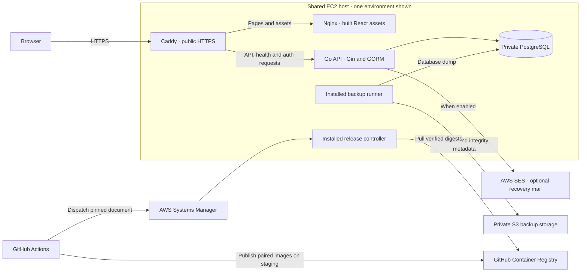

# Vellum technical architecture

[Project overview and setup](README.md)

Vellum records and summarises manually entered financial activity. Its main
correctness concerns are keeping users' records separate, preserving exact
amounts and calendar dates, and making internal transfers consistent with
account and spending totals. This guide describes the checked-in `staging`
implementation. Public environments can run different releases.

## Contents

- [System and repository](#system-and-repository)
- [Frontend](#frontend)
- [API and request handling](#api-and-request-handling)
- [Data and financial correctness](#data-and-financial-correctness)
- [Authentication and security](#authentication-and-security)
- [Delivery and recovery](#delivery-and-recovery)
- [Verification and trade-offs](#verification-and-trade-offs)

## System and repository



Caddy routes `/api` and `/ping` to Go, along with POST and OPTIONS on the
authentication and recovery paths. Browser navigation on those paths serves the
React single-page application through Nginx. The deployed frontend uses
same-origin API requests. Nginx and the API sit behind Caddy on the shared web
network. The database stays on the environment's internal network.

Local Compose runs Vite and a Go server with Air reload alongside PostgreSQL.
The browser talks directly to the API on a separate loopback origin by default.
Staging and production each run an Nginx frontend, a compiled Go service and a
separate PostgreSQL database with its own credentials, volume and Compose
project. They share Caddy and the EC2 host.

```text
.
├── frontend/
│   ├── src/                  React routes, features, shared UI, API and state
│   ├── tests/ and e2e/       Node checks and Playwright browser fixtures
│   └── scripts/              Isolated browser test runner and matrix
├── backend/
│   ├── cmd/server/           Server entry point and dependency wiring
│   └── internal/             API layers, data models, database and Go tests
├── deploy/
│   ├── cd/ and tests/        Release controller, smoke checks and safety tests
│   └── backup/               Backup and restore runbooks and templates
├── .github/workflows/        CI, staging delivery and manual production promotion
├── scripts/ci/               Check selection and release verification
├── docs/                     Project notes and screenshot assets
└── docker-compose.yml        Local development stack
```

The local API reads `backend/.env` or process environment variables. The frontend
takes its API origin from `VITE_API_BASE_URL` when Vite starts or builds the bundle. Deployed secrets are
read from root-owned files under `/etc/vellum-cd/`, separate from the checkout.
The installed controller checks ownership and rejects unsafe paths. GitHub
Environments supply deployment configuration to Actions. See the
[environment file handoff](deploy/ENVIRONMENT-MIGRATION.md) for the operational
boundary.

## Frontend

Vite builds the React and TypeScript client. TanStack Router generates and
splits file-based routes from [`src/routes/`](frontend/src/routes/). Routes
compose screens from [`src/features/`](frontend/src/features/), with shared UI
and layout kept separate. The workspace waits for the server to confirm an
account exists. A failed account check offers retry, and an empty account list
opens setup.

Typed Axios functions call the resource endpoints.
[FinanceDataContext](frontend/src/contexts/FinanceDataContext.tsx) loads accounts,
categories, transactions, transfers, budgets, goals and settings in parallel.
It keeps previous values when an individual resource fails, discards superseded
responses, and refreshes after saves and on window focus. Account balances and
allocations come from the server. Activity search, sort, CSV export and analytics
work over the collections already loaded into the browser.

Tailwind utilities and feature CSS support desktop and mobile layouts, including
stacked activity cards and a mobile sort control. The UI uses native modal
dialogs with Escape handling, labelled controls and focusable chart details.
These are specific implementation practices. The browser suites cover a subset
of keyboard, mobile and layout behaviour.

Form failures surface through the relevant UI. Resource failures remain scoped
to the screens that use the affected data. The recovery form handles throttling
explicitly. Refresh and revocation calls have client deadlines. General
requests have no Axios deadline, and the API bounds request work server-side. A protected `401` can retry once after
session refresh. Transport failures and throttled writes are surfaced to the
caller so they do not silently submit the same operation again.

## API and request handling

[`cmd/server`](backend/cmd/server/) wires Gin routes, middleware, handlers,
services and GORM repositories. Handlers decode input and map application errors
to HTTP responses. Services apply validation and ownership rules. Repositories
scope user-owned collections and mutations and own persistence transactions.
Services check ownership of individual records before returning them.

| Route                                                                                | Responsibility                                 |
| ------------------------------------------------------------------------------------ | ---------------------------------------------- |
| `GET /ping`                                                                          | Health check                                   |
| `POST /register`, `/login`, `/refresh`, `/logout`                                    | Account creation and session lifecycle         |
| `POST /forgot-password`, `/reset-password`                                           | Recovery request and token redemption          |
| `/api/accounts`, `/api/transactions`, `/api/transfers`, `/api/budgets`, `/api/goals` | User-scoped records                            |
| `/api/categories`, `/api/settings`                                                   | Shared category reads and per-user preferences |

Protected requests pass source and global admission before session lookup, then
per-user admission after authentication. Limits include 64 KiB request
bodies, 2 KiB raw queries, 240 requests per minute per user, and concurrency
limits of 16 per user, 24 per source and 32 globally. Writes with a non-empty
body must supply a single JSON document. The API gives protected work a
10-second request deadline, with a shorter session lookup budget.

Malformed input returns `400`, unsupported media `415` and oversized bodies
`413`. Unavailable capacity returns `429` with `Retry-After`. Missing and
foreign resources generally return `404`, and constraint conflicts return
`409`. Cancellation and request deadlines map to `408` and `504` where a
response can still be sent. Context propagates to GORM and the database, but a
lost response or cancellation near commit leaves the client uncertain about
whether the write took effect. See the [resource limit contract](backend/RESOURCE_LIMITS.md)
and [backend API guide](backend/README.md) for configuration and details.

## Data and financial correctness

| Model                                      | Relationship and purpose                                              |
| ------------------------------------------ | --------------------------------------------------------------------- |
| User, settings, refresh token, reset token | Identity, per-user preferences and session/recovery state             |
| Account                                    | A user-owned tracking record with derived balance and goal summaries  |
| Transaction                                | Income or expense for an owned account and shared category            |
| Transfer                                   | One movement with two distinct owned accounts, source and destination |
| Budget                                     | One limit per user and category, enforced by a composite unique index |
| Goal                                       | Saved progress and target, optionally linked to an owned account      |

Amounts cross the API as integer minor units within JavaScript's exact integer
range. The forms parse decimal input before submission. PostgreSQL calculates
account summaries using exact numeric aggregates and the browser uses
`BigInt` for derived totals. Floating point is used for presentation such as
chart proportions. The range boundary protects amounts sent through the JSON
number contract.

Account balance is recorded income less expenses, plus incoming transfers and
less outgoing transfers. A transfer stores both account references in one row,
so editing or deleting it changes both effects together. It has zero net effect
across accounts and is excluded from income, spending and budget use. The
service checks ownership of both accounts. Database constraints require
existing, distinct accounts. Restrictive account references protect dependent records from
accidental deletion.

A goal reserves its full target against the linked account. Unallocated funds
equal recorded balance less linked targets and can show a shortfall. Updating
saved progress leaves the balance untouched. Summary-affecting writes acquire
a user-row lock and check their before-and-after ranges in the same database
transaction. This serialises writes that could otherwise pass range checks
individually and exceed the bound together. Legacy out-of-range data may stay
at its current violation or move towards a valid range.

### Follow a transfer through the code

The [transaction form](frontend/src/features/transactions/components/NewTransactionDialog.tsx)
converts the amount to minor units and calls the
[transfer endpoint module](frontend/src/api/endpoints/transfers.ts). It keeps
inputs and an error visible if submission fails. On success the finance context
reloads the shared resources. The
[financial repository](backend/internal/repository/financial.go) derives the
new balances, while the [overview](frontend/src/features/overview/pages/Home.tsx)
uses transactions for income and expense totals.

The [finance regression](frontend/src/features/transactions/utils/activity.test.mjs)
uses £1,000 of income, a £200 transfer and a £10 expense. The two accounts show
£800 and £190, while total net stays at £990. The
[browser workflow](frontend/e2e/workflows.spec.ts) exercises persisted balances
through the application. Run the calculation checks with `pnpm test:finance`
from `frontend/`.

### Calendar dates and startup

Ledger dates represent the entered calendar day. Forms send `YYYY-MM-DD`; the
API also accepts RFC3339 and preserves the day written in the input before
normalising it to UTC midnight. Older timestamps use their stored UTC day.
Transaction range filters use inclusive calendar endpoints at most 366 days
apart, implemented with an exclusive midnight after the last day. The viewer's
local calendar determines the current month. Authentication expiry and creation
times remain timestamps.

Startup runs a duplicate-budget preflight, GORM AutoMigrate and idempotent
category seeding before serving traffic. The preflight stops on duplicate
user/category groups for explicit resolution. Migration uses a dedicated
single-connection pool with its own timeout budget. The runtime pool caps
connections at 16 open and eight idle, with PostgreSQL statement, lock and
idle-transaction timeouts. See the
[server startup](backend/cmd/server/main.go) and
[database configuration](backend/internal/database/) for the exact defaults.

## Authentication and security

Passwords use bcrypt. Registration commits the user, default settings and
initial refresh-token hash together. Sign-in creates a session family. Short-lived
HS256 access tokens bind to the user's authentication version and the active
family. Random opaque refresh tokens are stored as SHA-256 hashes and rotate
transactionally. Logout revokes the family even if the supplied token was
already rotated, so a later protected request using a revoked family's access
token fails. Other login families stay separate. Legacy access tokens issued
before family binding follow their expiry and authentication-version checks.

The browser stores one credential record in `localStorage`. Web Locks coordinate
refresh across tabs in a secure context, with a separate short lock for
credential updates. The record's generation identifies the sign-in and its
revision tracks rotations. This prevents an old response from replacing a newer
session or replaying a request under another login. Logout immediately writes a
credential-free record across tabs. Server revocation depends on delivery of
the request. See the [frontend session protocol](frontend/README.md#authentication-flow)
for the browser ordering details.

Password recovery returns a generic response for a well-formed request. A
bounded, in-memory worker can send mail through AWS Simple Email Service (SES).
The short-lived token is hashed at rest and placed in a URL fragment. The
browser strips the fragment and sends the token in the reset request body.
Successful redemption atomically replaces the password, increments the
authentication version, revokes refresh sessions and consumes outstanding
reset links. Sending defaults to disabled. Staging sending requires a
recipient allowlist, and the shared EC2 role makes that allowlist an application
control. See the [password recovery runbook](deploy/PASSWORD-RESET.md).

CORS restricts browser origins and Gin trusts forwarded client addresses only
from configured proxy networks. Auth endpoints have separate body, rate and
concurrency limits. Application request logs use route templates and status
instead of logging request bodies or query values. Deployed application
containers run as non-root with read-only filesystems and dropped capabilities.
The Nginx configuration ships a report-only Content Security Policy (CSP) and
the browser matrix exercises enforcement as well. Script compromise remains
a session exposure because JavaScript can read `localStorage`. See the
[CSP runbook](deploy/CONTENT-SECURITY-POLICY.md).

## Delivery and recovery

[GitHub Actions CI](.github/workflows/ci.yml) selects checks by changed paths,
while preserving required check contexts. A release-needed push to protected
`staging` runs full validation. If delivery is enabled, it publishes a paired
backend and frontend build to GitHub Container Registry (GHCR) and deploys the
pair by immutable digest. After smoke checks through Caddy, the workflow keeps
a verified manifest with both digests and the hashes of the six-file controller
bundle. Manual staging verification creates separate evidence.

Production uses a [manual workflow](.github/workflows/release-production.yml)
on protected `main`. After review and merge, the operator dispatches **Promote
production** with one confirmation checkbox for replacement, API downtime,
migrations and smoke requests. The workflow discovers one eligible ordinary
staging-push release whose tracked release inputs match `main` and revalidates
the artifact provenance, hashes and digests. It deploys the tested images without
rebuilding. GitHub obtains temporary AWS credentials through OpenID Connect
(OIDC) and invokes a fixed, version- and hash-pinned Systems Manager (SSM)
document that calls the trusted controller on EC2.

The controller checks the installed bundle, pulls both digests, removes old
backend writers and drains database clients in the target environment before
starting one backend. That barrier protects startup migration and session
changes from older writers. Health and Caddy smoke checks precede durable
release receipts. PostgreSQL and the shared proxy stay in place.

Host coordination has three distinct signals:

- **Backup status** is advisory for release decisions. The backup runner
  creates a PostgreSQL dump and uploads the archive and integrity metadata
  to private S3. Freshness and optional alerts help operators see failures.
  Successful upload establishes transfer evidence. A restore drill exercises recovery.
- **Active host locks** exclude overlapping managed backups, deployments
  and schema work across both environments. Work fails early on contention.
- **A durable pending-operation marker** records a guarded operation that may
  have left work in flight. Deployment retains it after incomplete work. Backup
  retains it if the dump phase fails or is interrupted. A later upload failure
  is independent of that guard. A free lock cannot prove that daemon or database
  work has stopped, so the host recovery procedure governs clearance.

Image rollback does not reverse an AutoMigrate schema change or restore writes.
The controller leaves incomplete operations for reviewed recovery. Keep the
matching tooling, compatible images and database recovery evidence available.

Use the [CI/CD guide](deploy/CI-CD.md), [change selection guide](deploy/CI-OPTIMISATION.md),
[production promotion runbook](deploy/PRODUCTION-ACTIVATION.md),
[host coordination runbook](deploy/HOST-COORDINATION.md),
[backup guide](deploy/backup/README.md) and [isolated restore runbook](deploy/backup/RESTORE.md)
for procedures. The source describes these controls. Their activation depends
on GitHub, AWS and the installed host configuration.

## Verification and trade-offs

| Check                         | Evidence and prerequisites                                                                                                                                                                                               |
| ----------------------------- | ------------------------------------------------------------------------------------------------------------------------------------------------------------------------------------------------------------------------ |
| Frontend units and boundaries | `pnpm test` in `frontend/` checks finance, session and architecture behaviour, among other contracts. `pnpm build` type-checks application code.                                                                         |
| Backend checks                | `go build ./...`, `go vet ./...` and `go test ./...` in `backend/`. A disposable PostgreSQL DSN enables integration and race coverage for transactions, ownership, concurrency and migrations.                           |
| Browser workflows             | `pnpm test:e2e` owns a disposable Docker stack. Desktop Chromium, Firefox and WebKit and mobile Chromium/WebKit cover representative user flows. `pnpm test:e2e:csp` runs the matrix in reporting and enforcement modes. |
| Deployment contracts          | CI exercises release selection, manifest and controller safeguards, Compose and Caddy validation, Docker build context exclusions and production images. See [CI](.github/workflows/ci.yml).                             |

The single EC2 host simplifies operation and gives staging and production a
shared failure boundary. Rate counters are bounded in memory and reset on
restart. Additional replicas would have independent counters.

Complete list responses and browser-side filtering keep the client simple at
the current scale. Payload size, correlated balance queries and client work
grow with account history. Pagination or incremental loading would be a separate
change. Startup migration simplifies setup, while schema rollback and ambiguous
write outcomes still require explicit recovery decisions.
