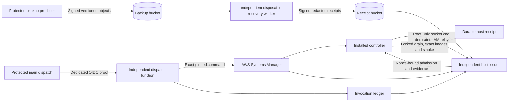

# Independent production recovery

**Repository implementation in draft. Activation is blocked.** The automated
authority can admit an unchanged backend and deployment bundle after a qualifying
restore and independent release approval. Changed backend execution still
requires attended maintenance. A standalone exact-image rehearsal is available
for that review. The checked-in workflow defaults to standard approval.

## Trust and acceptance

| Identity | Authority and limits |
| --- | --- |
| Protected production GitHub job | Invoke only the immutable dispatch function and read SSM status. It has no SSM send, backup read or signing permission on the automated role. |
| Independent dispatch function | Read canonical GitHub provenance and signed recovery receipts. Issue only the pinned production command and reserve the workflow attempt before the non-idempotent AWS call. It has no issuer signing permission. |
| EC2 root and local relay | Measure host state and enforce the writer barrier. A root-only Roles Anywhere certificate provides narrowly scoped host-function invocation. Root and the Docker daemon are trusted for host measurements. Compromise of either can bypass the local controller. |
| Root backup producer | Authenticate the PostgreSQL source and snapshot and publish versioned objects. Keep its private key out of application mounts, the instance metadata role, GitHub and the issuer. A compromised producer or database administrator can falsify origin or data. |
| Recovery worker | Read only exact private backup versions. A separate KMS key signs worker receipts. PostgreSQL restore and candidate execution use network-disabled containers with bounded scratch. The candidate sees only a disposable read-only PostgreSQL standby. |
| Independent host issuer | Read invocation, ledger, approval and recovery receipts. Sign only the exact authorised request with its separate KMS key. The issuer has no archive-content permissions. |

The issuer trusts GitHub's signed OIDC job identity, the independently retrieved
current attempt, and the exact hash-pinned production workflow whose server-side
job condition requires the affirmative checkbox. The token has no checkbox
claim. The issuer also pins the Environment's branch rules and the reviewed
protection rules. It checks approval/run state at dispatch and again while the
command is executing. A cancelled or rerun attempt cannot obtain a new signature.
Cancellation after the host accepts fresh evidence and begins mutation is
handled as an interrupted deployment through the pending marker. Where the
Environment requires a reviewer, the authority also checks review history.
That GitHub history is run-scoped, so use a fresh dispatch after a rerun.

After AWS accepts `SendCommand`, the authority records the actual command UUID.
The host challenges using the SSM Agent's UUID. Admission permits a bounded
visibility retry; dispatch is never automatically resent. The issuer verifies
the actual document owner, numeric version, AWS metadata hash, target, manifest
parameter and running plugin. It independently verifies the successful staging
command and the current GitHub release attempt. An artifact can be retained for
90 days, but automated admission also requires the staging command still to be
available in SSM command history. Use a fresh ordinary staging release if that
history has expired.
[AWS command history](https://docs.aws.amazon.com/systems-manager/latest/userguide/running-commands.html)

| Scenario | Automated result |
| --- | --- |
| Frontend-only or exact backend execution unchanged | May proceed with a matching bundle, restricted serving profile, approved baseline and current signed evidence. |
| Changed backend with matching migration contract | Standalone exact-image rehearsal is available. Automated dispatch does not orchestrate or admit this class yet. |
| Changed schema, indexes, constraints, data transformation, seeding or unknown effects | Reviewed maintenance. Run the exact controlled migration separately with bounded locking and operator recovery approval. |
| Missing/stale backup or drill, unavailable issuer, wrong SSM pins or command, host/proxy/runtime drift | Fail before writer drain where detected in preflight. Expiry is checked again with the host locks held. |
| Interrupted after the pending marker | Preserve the marker and protected evidence. Verify quiescence and use the existing host recovery procedure. |
| Image or approval-system rollback | Separate review. Review the migration contract and database state independently of image identity. Preserve receipts and the lock inodes. |

## Repository and activation boundaries

The implementation in this directory is a reference for a separately reviewed
installation. Its [authority Terraform](infra/main.tf) provisions two immutable
Lambda functions, separate roles, a DynamoDB invocation ledger, a KMS release
issuer key and bounded CloudWatch log retention. Use an independent recovery
state with encrypted, access-controlled backend and its own review workflow.
Do not put secret values in variables or state. Provide a reviewed immutable
Lambda image, a secret ARN for an independently scoped GitHub read credential,
existing Roles Anywhere trust and profile, and production/staging document pins.
The operator creates and scopes the worker-specific storage, scheduler, signing
key and alarm target separately from the authority. Worker and receipt access
must remain outside the production application role. See the
[worker provisioning and monitoring instructions](WORKER.md).

Required authority configuration fields:

- `repository_id`, `audience`, `workflow_sha256` and
  `environment_protection_sha256`. Hash exact reviewed workflow bytes and the
  canonical JSON of the reviewed protection-rule list. Restrict the production
  Environment to the single branch `main`. Keep existing review requirements.
- `github_secret` (reference only), `receipt_bucket`, `receipt_account`,
  `worker_profile_sha256`, `worker_public_keys.backup` and
  `worker_public_keys.drill`. The independent GitHub credential needs Actions
  and contents read access and access to read the deployment environment
  restrictions. Verify its exact access on a disposable repository.
- `staging` and `production`, each with `document`, `version`, `sha256` and
  `instance`. Supply AWS-reported pins for both documents and inspect every
  historical version executable by the deploy identities.
- `initial_manifest_sha256` and `live_policy`. Independently verify the
  initial production receipt and exact policy fields
  `postgres`, `schema_sha256`, `migration_contract_sha256`,
  `database_source_sha256`, `proxy_sha256`, `backup_contract`,
  `execution_sha256` and `runtime_sha256`.

The state also needs a separately scoped ECR repository and reviewed Python
3.12 AL2023 Lambda base image by digest. Build the authority image from the
verified repository root using `Dockerfile.authority`; deploy the resulting
Linux/AMD64 image by ECR digest after review. The root relay's config has
`function` (exact version ARN) and `aws_config`
(`/etc/vellum-cd/recovery-relay-aws.conf`). Use the dedicated
`vellum-recovery-relay` AWS CLI profile with Roles Anywhere credential helper.
Restrict that profile to the single relay certificate and role. Protect the
credential process, private key, certificate and config as reviewed root-owned
files. Verify revocation, certificate expiry and denied cross-role requests.

## Ordered activation and operation

1. Prove real AWS metadata and GitHub approval semantics in a disposable
   environment. Verify the KMS/OpenSSL signature pair, independent role
   boundaries, worker scheduling and alert delivery. The signed approval
   integration test uses fake GitHub, SSM and receipt storage.
2. Separately approve and provision the private recovery resources. Apply
   the v2 backup contract only after verifying the dedicated bucket, lifecycle,
   conditional writes, version IDs and producer key. Obtain a genuine backup.
   Independently prove a restore, a failed drill alarm, missing-proof alert
   and the worker's network and credential isolation.
3. Approve the [runtime role transition](runtime/README.md) and the paired
   six-file controller installation under the shared host freeze. Install the
   reviewed `runtime_policy.sql` as root-owned 0600
   `/etc/vellum-cd/production-runtime-policy.sql`; its bytes must match the
   controller pin. Keep bootstrap and serving credentials distinct. Use
   `VELLUM_BACKEND_COMMAND=serve`, `VELLUM_RUNTIME_DB_USER=vellum_runtime` and
   the root-private `VELLUM_RUNTIME_DB_PASSWORD` after the role transition.
4. Obtain an ordinary staging release with the installed bundle. Use standard
   approval to establish the actual current production receipt. Refresh the
   source-bound backup and qualifying restore against that resulting baseline.
5. Verify protected policy and key files, relay, versioned Lambda functions
   and the new numeric SSM document and AWS metadata hash. Set the automated
   GitHub Environment's `AWS_READINESS_ROLE_ARN`,
   `VELLUM_DISPATCH_FUNCTION`, and `VELLUM_DISPATCH_AUDIENCE` from reviewed
   provisioning outputs. Keep the existing standard role and environment
   approval guard during transition. Activate `PRODUCTION_READINESS_MODE=automated`
   only after the corresponding host policy and retained evidence have been
   verified. Obtain separate approval for the first live production exercise.
6. For an eligible release, merge the tested staging tree into protected
   `main`. Run **Promote production** on `main` and tick the confirmation.
   Satisfy any configured Environment review. The job reports the accepted SSM
   UUID, verifies the exact host receipt and records the independently
   confirmed outcome. A failed or ambiguous result is investigated using the
   SSM UUID, worker receipts and protected host state.

For key rotation, freeze new dispatch and recovery jobs, drain active work,
install the reviewed replacement keys and immutable service versions, verify a
new independent receipt chain, then retire the old invoke and sign grants.
A failed rotation leaves automation stopped. For approval rollback, use a
separately reviewed drained change to the verified standard policy and fresh
standard evidence. Keep historical receipts and pending state. A transient
issuer or relay outage never falls back to a weaker path.

Keep raw PostgreSQL output, SSM inputs, production env, provider state,
credentials and recovery data out of GitHub logs. An abrupt host stop can leave a root-private `.production-env-*` snapshot
under the controller state directory. Handle it privately during coordinated
recovery after verifying quiescence. Keep worker receipts for at
least 30 days in the independent private bucket. Retain confirmed invocation
outcomes independently of SSM's command-history window. Monitor failure,
absence of new verification evidence, snapshot age and drill age separately.
See the [London cost estimate](../PRODUCTION-RECOVERY-DECISION.md#london-cost-envelope).
Fixed private endpoints and existing compute availability dominate the
recurring cost at this workload. No new always-on host is provisioned here.
